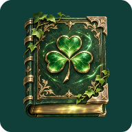
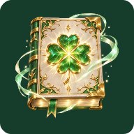

# Grimórios de Polaris

Coleção ilustrada inspirada na progressão dos trevos e na atmosfera de Black Clover, solicitada pelo usuário. Quatro artes novas geradas com `image_gen.imagegen`, com textura de couro, folhas metálicas, páginas luminosas e fundo transparente. Os originais ficam preservados; os recursos Android apenas foram redimensionados e codificados em WebP. [Proveniência e hashes](provenance.json).

O Grimório Polaris fica sempre disponível. Para cada alternativa, basta uma condição:

| Grimório | Pontos de leitura | Obras na biblioteca | Obras iniciadas | Obras concluídas lidas |
| --- | ---: | ---: | ---: | ---: |
| Trevo de três folhas | 900 | 5 | 3 | 1 |
| Quatro folhas · Amado pela mana | 4.500 | 25 | 10 | 5 |
| Trevo de cinco folhas | 9.000 | 100 | 25 | 10 |

As folhas de cada emblema foram contadas visualmente: três, quatro e cinco. A edição de quatro folhas representa a bênção da mana; a última tem aparência mais sombria. O grimório inicial conserva a estrela de Polaris.

Além dos pontos, [conquistas da biblioteca, exploração e conclusão](../../../docs/CONQUISTAS_GRIMORIOS_P20261112_1.md) agora liberam os grimórios. Basta um caminho por ícone. Os marcos de pontos, desbloqueios anteriores, escolha salva e aliases Android continuam os mesmos. Trocar não gasta pontos. Os nomes internos `DEFAULT`, `AURORA`, `ORBIT` e `CONSTELLATION` são preservados para compatibilidade; a interface mostra os nomes da nova coleção. O tema de aparência Aurora continua sendo um tema, separado do nome dos ícones.

Os quatro recursos de 512×512 somam **414.354 bytes**, sem acrescentar dependências nem modelos. A coleção anterior de [guardiões](../../polaris-guardians/20261111/README.md) permanece arquivada no projeto.

| Grimório Polaris | Três folhas | Amado pela mana | Cinco folhas |
| --- | --- | --- | --- |
|  |  |  |  |

[Seleção dos ícones](../../../integration/grimoire-achievements/20261112/preview/appearance/appearance-aurora-light.png) e [exemplo de conquista da biblioteca](../../../integration/grimoire-achievements/20261112/preview/appearance/achievements-library.png), capturados no Android API26.

Originais: [Grimório Polaris](originals/default.png), [três folhas](originals/three.png), [quatro folhas](originals/four.png) e [cinco folhas](originals/five.png).

O grimório inicial teve a névoa externa removida por edição com `image_gen.imagegen`; a primeira versão está em `history/`. As margens adaptativas são de 22%.

[Implementação e validação P20261112.1](../../../docs/CONQUISTAS_GRIMORIOS_P20261112_1.md).
