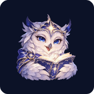
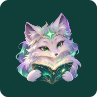
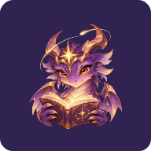
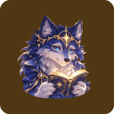

# Guardiões de Polaris — ícones ilustrados

Coleção histórica P20261111.1 preservada. A revisão seguinte adota a [coleção de grimórios e trevos](../../polaris-grimoires/20261111/README.md).

Quatro ilustrações originais geradas com `image_gen.imagegen`, com fundo transparente, rosto expressivo, livro e estrela de Polaris. As artes originais foram preservadas; as cópias Android somente foram redimensionadas e codificadas em WebP, sem redesenho por formas geométricas. [Proveniência e hashes](provenance.json).

| Ícone | Guardião | Liberação |
| --- | --- | --- |
| Original | Coruja prateada | Sempre disponível |
| Aurora | Raposa boreal | 900 pontos |
| Órbita | Dragão celestial | 4.500 pontos |
| Constelação | Lobo estelar | 9.000 pontos |

Os pontos vêm do progresso de leitura existente, sem um segundo saldo e sem gasto ao trocar. Com 90 pontos por capítulo lógico, os marcos correspondem a 10, 50 e 100 capítulos para um perfil novo. Migrações preservam progresso anterior e o ícone já escolhido. Ícones liberados permanecem disponíveis. Temas e capacidades do leitor continuam livres.

Os quatro recursos de 512×512 somam **366.210 bytes**. Os ícones adaptativos mantêm margens proporcionais para as máscaras do Android; o tema monocromático usa a transparência da própria ilustração. Os aliases mantêm os nomes existentes e a MainActivity não é desativada. A rodada API26/x86_64 conferiu os quatro aliases e renderizou os ícones reais pelo PackageManager; máscaras e ícones temáticos de outros sistemas ainda precisam de aceite.

| Original | Aurora | Órbita | Constelação |
| --- | --- | --- | --- |
|  |  |  |  |

[Tela de seleção no Android](../../../integration/sessions-icons/20261111/preview/appearance/appearance-aurora-light.png), com Aurora selecionada e Constelação ainda bloqueada no exemplo de 4.500 pontos.

Artes: [coruja](originals/default.png), [raposa](originals/aurora.png), [dragão](originals/orbit.png) e [lobo](originals/constellation.png).
