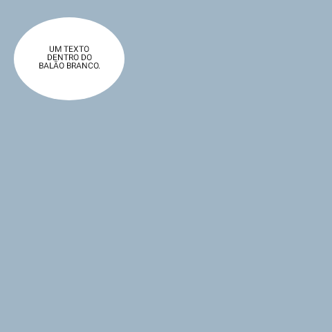

# Balões, opções de OCR e download de atualizações

Candidato interno **0.1.0-beta.9 / P20261104.1 / versionCode 110**. A beta.8 pública e seus anexos permanecem preservados. Esta rodada não acrescenta modelos nem APIs; mantém APKs ARM32 e ARM64 para Android 8+.

## O que as referências mostram

As capturas do leitor incluem títulos sobrepostos, legendas em fundo escuro com texto fora da caixa, texto pequeno em balões conectados, painéis decorados e trechos em inglês ainda visíveis. A fonte selecionada é Anime Ace. PaddleOCR, faixas, DBNet e AOT-GAN estavam selecionados simultaneamente. As imagens registram o resultado exibido, mas não contêm o original completo nem os blocos de OCR salvos. Assim, uma linha em inglês pode indicar falha de reconhecimento, agrupamento ou limpeza; a captura isolada não identifica qual etapa falhou.

O relato de atualização é separado: três tentativas não finalizaram durante uma viagem; baixar o APK no GitHub e instalar por cima funcionou. Não há registro de rede dessas tentativas para determinar a causa exata.

## Correções na leitura

- Quando não encontra um contorno de balão, o analisador agora limita também a área alternativa de escrita ao fundo medido. Antes, só o caminho com contorno detectado recebia essa proteção.
- O leitor aloca as áreas dos blocos em conjunto, tanto no paginado quanto na faixa longa. Áreas de escrita sobrepostas são separadas conforme as regiões de origem. Isso impede que títulos de tamanhos diferentes disputem o mesmo espaço. As traduções e os textos de OCR permanecem intactos.
- Legendas coloridas sem contorno ficam limitadas também pela região de limpeza já salva. Essa proteção alcança traduções antigas; a correção do analisador exige refazer a tradução.
- A limpeza por cor respeita o retângulo medido. O preenchimento extra acrescentado pelo renderizador podia ultrapassar a proteção do contorno. Máscaras experimentais DBNet mantêm seu contrato separado.

As operações de cor do analisador usam os mesmos canais ARGB de 0 a 255, com operações puras. As antigas matrizes de teste agora suportam a leitura em lote de pixels que o código real executa. Isso corrige os controles de teste e evita o registro excessivo de chamadas de mocks no processamento de imagens.

Esses ajustes não comprovam recuperação de todas as linhas ausentes, correção linguística, bom uso de todo balão conectado ou reconstrução fiel de painéis decorados. Os controles de renderização são imagens autorais simples e usam a fonte padrão, não o capítulo nem a fonte Anime Ace das capturas.

## Opções que correspondem ao processamento real

DBNet usa reconhecimento ML Kit de página inteira. O motor selecionado funciona como reserva nesse modo; selecionar PaddleOCR não garante que ele processou aquela página. Faixas e DBNet não se combinavam no processamento, embora a tela permitisse ativar ambos.

Agora, habilitar um desses experimentos desliga o outro. Ao encontrar as duas opções antigas ligadas, o app conserva faixas com o motor escolhido e desliga DBNet. O mesmo ajuste é aplicado ao criar o OCR e ao abrir as configurações.

A opção AOT-GAN foi retirada da tela: sua preferência não era consultada pelo processamento de tradução. Sua marcação não comprovava remoção neural de texto. O código experimental e a chave antiga permanecem compatíveis, mas não são apresentados como recurso ativo.

Alterar o motor ou as faixas não refaz a tradução salva. Para comparar o mesmo capítulo, use o **ícone de tradução → Excluir**, que remove somente a tradução; depois traduza novamente. Preserve o capítulo baixado. Retraduzir uma frase pelo editor usa o texto já reconhecido e não compara OCRs.

## Download recuperável

O código anterior cancelava a tarefa quando a tela de atualização era encerrada. Também encerrava a tentativa após uma exceção de rede, sem repetir automaticamente, e salvava diretamente em `update.apk`.

O candidato passa a:

1. Manter o download ao sair da tela, usando a tarefa persistente do Android.
2. Guardar os bytes incompletos em um arquivo `.part` no cache interno. A identidade inclui URL e SHA-256; outra versão não reaproveita esses bytes.
3. Solicitar o restante com HTTP Range. Uma resposta 206 precisa declarar a posição correta. Se o servidor responder 200, recomeça de forma limpa, sem anexar um segundo APK aos bytes antigos.
4. Tratar 416 verificando se todos os bytes já chegaram. Somente um arquivo com o SHA-256 esperado é promovido; um parcial inválido é descartado e solicitado novamente.
5. Repetir erros transitórios de rede e HTTP 408/429/5xx, com até cinco repetições automáticas e espera crescente. A tarefa exige conexão; a tela indica quando aguarda retomada. Após o limite, oferece tentar novamente e preserva o parcial aproveitável.
6. Conferir o SHA-256 do arquivo completo antes de promovê-lo atomicamente a `update.apk`. O progresso de sucesso só chega a 100% após essa etapa.
7. Oferecer instalação na tela e por notificação de conclusão, quando permitida. O instalador do Android continua solicitando a confirmação da pessoa.

O download usa fluxo com buffer de 64 KiB. O APK pronto pode ser reutilizado após nova verificação do hash. Pedidos antigos sem hash não retomam bytes: as atualizações oficiais do Polaris já exigem hash no manifesto. O Android pode remover o cache por falta de espaço, caso em que a transferência precisa recomeçar. O código não supera restrições de bateria ou execução impostas pelo sistema.

Cada versão continua usando um **APK completo**. A retomada economiza o que já foi recebido desse mesmo APK. Atualizações por diferenças exigiriam gerar e distribuir patches por versão de origem/arquitetura, reconstruir e conferir o APK resultante e manter uma alternativa de download completo. Essa infraestrutura fica fora desta correção.

O código novo só funcionará depois de instalado: ele não altera o atualizador da beta.8 já presente no aparelho. Pode ser necessário instalar manualmente este candidato uma vez quando ele for distribuído.

## Evidência e aceite

Os testes HTTP locais exercitam o código do downloader com conexões reais, incluindo transferência interrompida, nova instância da tarefa, cancelamento, 200/206/416, resposta de faixa inválida, hash incorreto, erro 503 e reutilização de arquivo pronto. Não dependem do GitHub nem simulam Android/WorkManager.

Os controles de imagem verificam fundos escuros em três escalas, caixas coloridas, balões brancos e separação de títulos. O ensaio Android usa uma Application isolada porque a imagem AOSP de teste não tem WebView; ele não valida a abertura completa do leitor. O resultado final de compilação, comparação de testes, execução Android e hashes fica em [TEST_RESULTS.json](../integration/document-reader/TEST_RESULTS.json).

A comparação completa executou **616 testes JVM: 599 aprovações e 17 falhas preexistentes**, sem novos erros, testes ausentes ou ignorados. Todos os 27 casos acrescentados passaram. Os **sete testes Android de componentes** também passaram; quatro verificam renderização, dois o decodificador e um a máscara de limpeza. A execução de renderização ocorreu antes das mudanças do atualizador; os arquivos de renderização/decodificação permanecem iguais no pacote final.

Exemplo autoral de legenda escura renderizada no Android, com ampliação de 2× e fonte padrão:

Controle autoral de balão branco:

Os APKs finais ARM32/ARM64 têm assinatura e identidade verificadas. Uma nova embalagem ZIP removeu espaço não utilizado deixado pelas compilações incrementais; cada APK ficou 1.562.260 bytes menor que o da beta.8 pública. Todos os arquivos de aplicação dentro dos APKs conferem byte a byte com os da compilação de testes; modelos e bibliotecas nativas não mudaram.

Ainda precisam de aceite no aparelho: retomada ao alternar rede, sair/voltar à tela, notificação e instalação sobre a versão anterior, biblioteca preservada e comparação das páginas reais nos dois leitores. O mecanismo de tradução continua sendo o ML Kit escolhido pela pessoa; Gemini permanece fora desta rodada.
