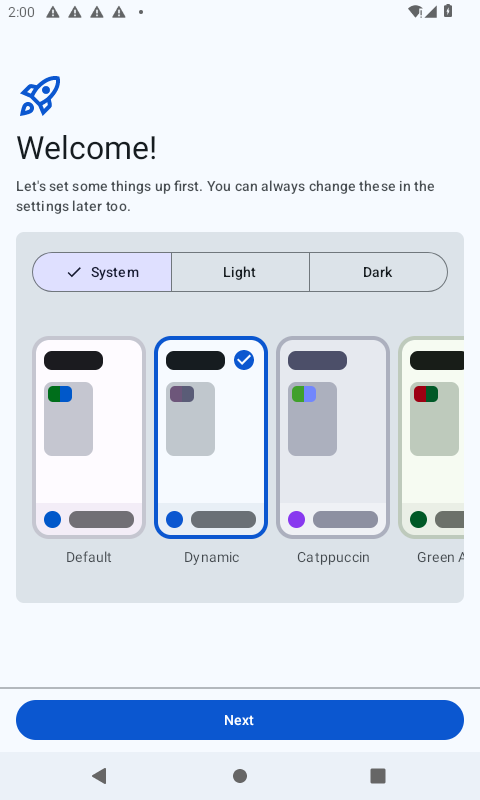
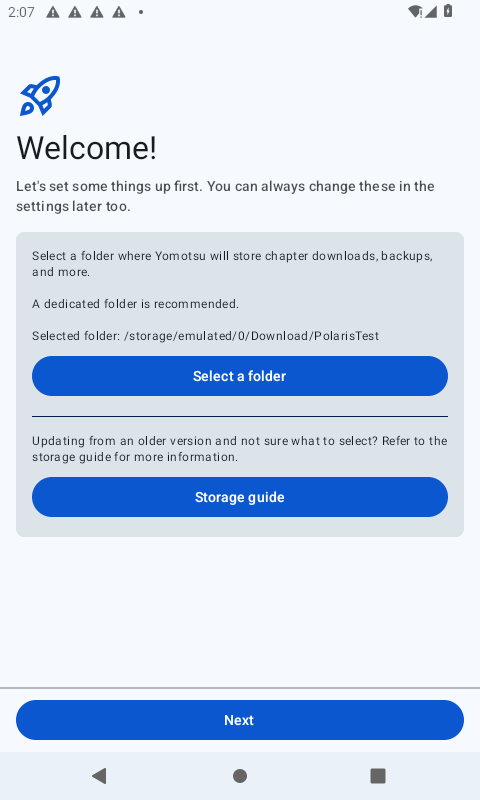

# Issue #2 — software emulator execution

Date: 2026-10-07. Current gate: **A01 PASS (API31/x86_64); B01/B02/B03 pending**.

## What actually ran

- Android Emulator 37.2.12 (build 16428233), software CPU (`-accel off`), software graphics, headless 480×800, 2 GiB guest RAM. Host has no `/dev/kvm`.
- First image: Google APIs Android 11/API30/x86_64. Its system-server watchdog killed Android during baseline installation (`Broken pipe`); this occurred before Yomotsu could open. The app was not established as the cause.
- Second image: Google APIs Android 12/API31/x86_64, with advertised ARM64 native-bridge support. Applied `ro.hw_timeout_multiplier=10` through rooted ADB and restarted Android services. The emulator's non-qemu `-prop` option was ignored; the run verifies the actual value through `getprop`.
- Google Play Services, Photos, Contacts Sync and Maps were disabled **in this disposable test image** to reduce unrelated background work. These are test conditions; no translation/ML Kit acceptance is claimed.
- Added the execution environment's public CA certificates to the guest user CA store. Yomotsu's existing network security configuration already trusts user certificates. Configured Android's explicit HTTP proxy through the emulator gateway because guest UDP DNS was unavailable. The host proxy port is session-specific and must be refreshed after restart.
- ARM64 streamed install exceeded the 420-second host timeout. The immediate package query was empty. Later x86 replacement logs indicate a previous app code path existed, consistent with a late completion of the earlier install; **no successful ARM64 UI launch was recorded**.
- x86_64 baseline: compressed ADB push followed by local `pm install --abi x86_64 -r ...` returned `Success`; `am start` opened `MainActivity`; the actual onboarding UI rendered, navigated, and accepted a `PolarisTest` folder. The pinned tracked Yomotsu source remains unchanged.
- Baseline x86_64 APK SHA-256: `925841670a6e9f44421b54c6f046c37540bd16f13d94cdbccb0564b62d43e665`.
- Patched x86_64 build SHA-256 (not yet installed at this checkpoint): `7ca559557cf273009cbae464cef507cd527f96cb118730761d9a0ce20216c16d`.
- Real extension install controls returned `Success`: MangaDex 1.6.0 and MANGA Plus by SHUEISHA 1.6.66 from the current Keiyoushi extension index. Yomotsu supports extension library versions 1.4 and 1.6. Installed extensions were still untrusted at this checkpoint; install alone does not prove source usability.
- The long-running execution tool ended the session with `network approval was cancelled before a decision was returned`. No QEMU process remained; the test disk and captured evidence survived. The exact cause was not exposed. Resume uses the same AVD with bounded sessions and a refreshed proxy.

## Reproduction and resume

Prepare Android SDK emulator plus `system-images;android-31;google_apis;x86_64`, and a Google APIs API31 AVD. The emulator requires roughly 7.4 GiB free at first userdata creation even when a smaller data partition is requested. The obsolete first test AVD/image were removed through the SDK managers after their evidence was saved.

The host lacked `libxkbfile.so.1`/`libXtst.so.6`; verified Ubuntu package archives were extracted to a temporary library directory. Supply that directory through `LD_LIBRARY_PATH` if necessary.

```bash
python3 scripts/r001/emulator_session.py \
  --sdk /path/to/android-sdk --avd polaris_api31 \
  --timeout-multiplier 10 --gpu swangle --cores 2 \
  --session /path/to/session --max-seconds 1800
```

The helper keeps emulator and ADB in one execution/network session, configures the diagnostic timeout through ADB, refreshes the explicit Android proxy when a localhost host proxy exists, and reads numbered JSON requests from `SESSION/requests`. Each request supplies an ADB `args` array, optional `timeout`, and an optional session-relative `output` filename. Results are written to `SESSION/results`. Screenshot requests use `exec-out screencap -p`; a `STOP` marker ends the session. Root timeout setup requires an image supporting rooted ADB and Android 12's hardware timeout property.

Only after a real UI has rendered should tests proceed. Cold software boot/class verification/rendering were slow, and System UI produced ANRs. This is functional integration evidence, not representative phone performance or an ARM64/DBNet/translation certification.

## Evidence and next gate

Raw install results, app startup logs, watchdog evidence and screenshots are in `evidence/issue002-emulator-2026-10-07/`.





Next: finish onboarding, trust both installed extensions, populate two real children of the same work, install the already-built Spike-001 x86_64 APK, create the virtual work through the debug hook, open real A/B chapters from its list, and remove one reference. Follow `ISSUE002_DEVICE_RUNBOOK.md`. Do not mark issue #2 passed, apply migration 15, or integrate issues #3–#7 before B01/B02/B03 evidence exists.

The diagnostic timeout mechanism is described in the [AOSP framework change](https://android.googlesource.com/platform/frameworks/base/+/0fcb8d6db42f6c20f6b69d47e02c54e2706f88f9%5E2..0fcb8d6db42f6c20f6b69d47e02c54e2706f88f9/).
