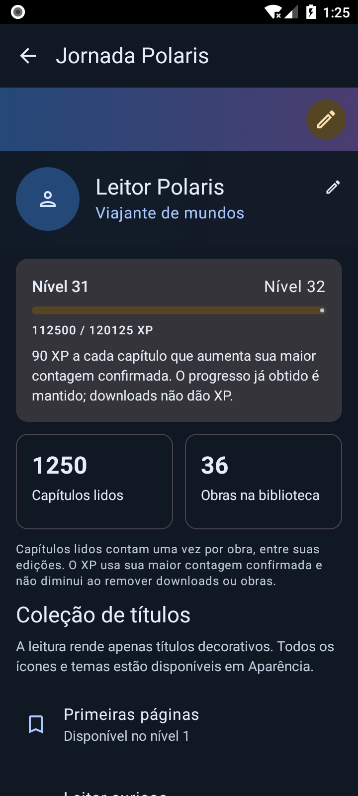
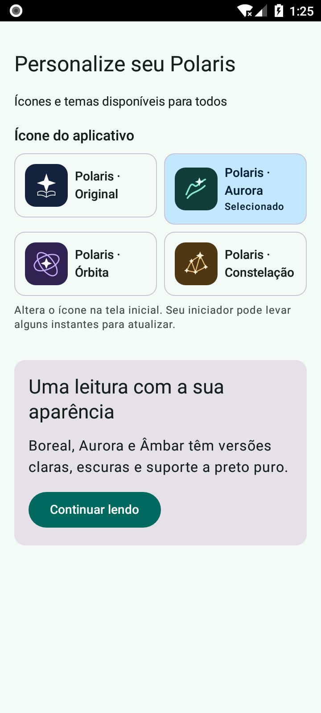
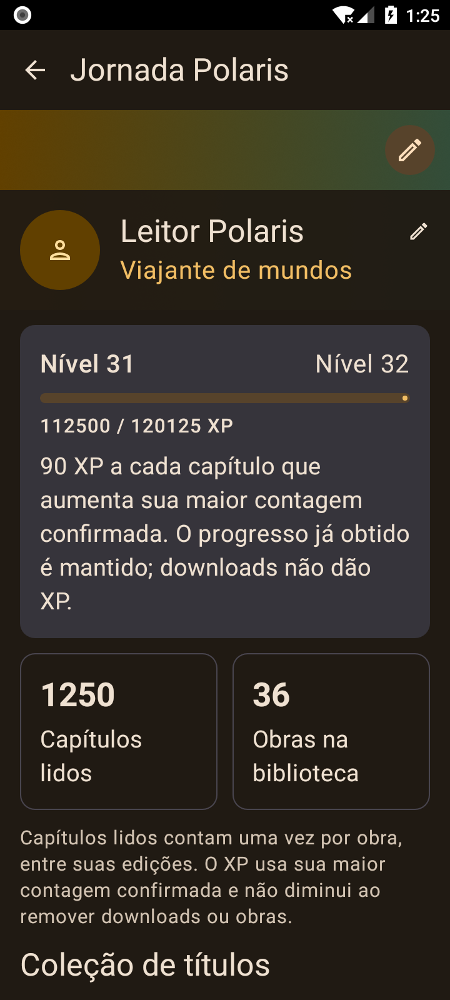

# Jornada Polaris, aparência e auditoria — desenvolvimento

Fonte de desenvolvimento da beta.11/código112, revisão P20261107.1. Sem publicação ou alteração da beta.10 pública.

[Auditoria geral e pendências planejadas](../../../docs/AUDITORIA_GERAL_P20261107_1.md).

Esta etapa reformula o perfil em títulos decorativos, introduz três ícones alternativos e três temas, corrige importação de imagens e contagem/XP, restaura as proteções do DBNet, valida configuração antes de inicializar tradutores remotos, protege callbacks de rastreamento e atualiza duas dependências com avisos conhecidos. Créditos e compatibilidade de ID/armazenamento/backups são preservados.

## Verificação

- **782/782 testes JVM passaram**, incluindo todos os 764 casos anteriores e corrigindo suas 17 falhas. Nenhum caso ausente ou ignorado. São 18 casos novos. [Comparação](unit-comparison.json) e [JUnit](junit).
- **13 controles passaram:** quatro do overlay (aplicação, deriva, idempotência, CRLF e gate de migração) e nove do empacotador.
- **11 testes Android passaram em API26 x86_64**, resolução 720×1600/dpi 320 e SELinux Enforcing: serviço/proxy real com extensão sintética compilada, idioma local, aliases/ícones/links, migração de preferências e exclusão de estado local do backup, persistência de sessão e PNG real. [Instrumentação](android-final.log).
- A primeira rodada gerou capturas cobertas por um diálogo de ANR do **System UI do emulador**, surgido no boot. Após tocar em “Wait”, somente o ensaio de capturas foi repetido: [um teste passou](android-preview-final.log), sem mudança de código. As imagens anteriores estão preservadas para diagnóstico; as três finais foram inspecionadas sem obstrução. Isso não mede desempenho de um celular.
- **335 caminhos do overlay conferem com os fontes compilados**, incluindo remoções. [Hashes](compiled-overlay.json). APKs locais são somente de instrumentação x86_64; não são APKs universais de distribuição.
- **Dependências Maven resolvidas:** 382 coordenadas/dois avisos antes; 380/nenhum aviso retornado depois. [Resultado posterior](dependency-advisories.json), [anterior](dependency-before/dependency-advisories.json), [grafo](runtime-dependency-graph.txt). Não inclui auditoria de todos os binários nativos ou APKs de extensões.

[Resultados estruturados e limites](TEST_RESULTS.json). [Hashes das evidências](SHA256SUMS.txt).

## Capturas finais

Dados sintéticos em uma atividade debug não exportada, sem carregar perfil pessoal. A galeria reutiliza os componentes reais de perfil/ícones/temas; não é aceite do fluxo completo com fontes/contas/aparelhos reais.

| Jornada · Boreal escuro | Aparência · Aurora claro | Jornada · Âmbar/fonte 1,3× |
| --- | --- | --- |
|  |  |  |

As correções anteriores de fontes/mesclagem/backup e seus limites permanecem descritos nas [evidências de continuidade](../../reading-continuity/20261106/README.md). Persistem pendências de biblioteca global, novels, sandbox ampliada, aparelhos ARM, navegadores reais, atualização e ida/volta por banco/interface do Mihon/Tachiyomi. Esta revisão não altera main, tags ou assets públicos.
