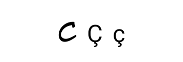
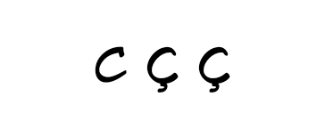
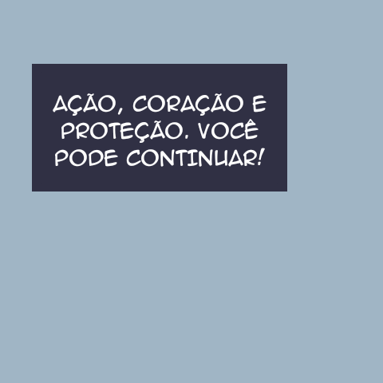
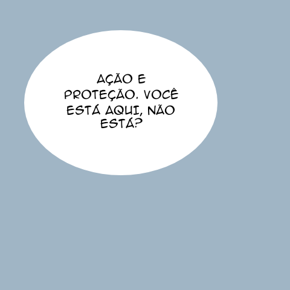

# Cedilha e encaixe — P20261104.2

A análise dos arquivos incluídos confirmou a falha relatada: `animeace.ttf` não contém U+00C7 nem U+00E7. Os caracteres **Ç/ç** eram desenhados pelo fallback do Android, com aparência e altura diferentes. Balsamiq Sans, Bubble Sans, Comic Spice e Manga Master contêm os dois caracteres. Veja [cobertura e métricas](font-coverage.json).

## Mudança

- Anime Ace recebe um complemento somente para Ç/ç, usando a Bubble Sans já incluída. A escala 1,125 aproxima a altura do C: Anime Ace 863/1024 e Bubble Sans 749/1000. Os caracteres reais permanecem no texto.
- Composição Unicode NFC usa glifos precompostos quando disponíveis. Não há remoção de acentos ou conversão de palavras.
- O medidor e o desenho usam a mesma `AnnotatedString`, incluindo tamanho e fonte do complemento.
- Espaçamento natural das fontes, padding de fonte e peso regular substituem o espaçamento de 0,98em e a herança da tipografia da interface.
- O ajuste compara todos os espaços seguros existentes e prefere o maior tamanho que caiba preservando palavras. Em empates, conserva o espaço mais restrito.

Nenhum arquivo de fonte, modelo ou biblioteca nativa foi modificado. Não há download adicional. O seletor foi esclarecido como **Fonte das traduções**. A família é escolhida pela pessoa; o aplicativo ajusta tamanho e quebra de linhas por região. Não há reconhecimento da fonte original de cada balão.

## Reprodução

Auditoria, sem editar fontes:

```sh
python scripts/ocr/audit_translation_fonts.py /caminho/yomotsu/app/src/main/res/font --output font-coverage.json
```

Requer `fonttools`. Os testes Kotlin constam no overlay `integration/document-reader/document-reader.patch`. As classes `PortugueseTypographyAndroidTest`, `TranslationTextFitAndroidTest` e `TranslationSurfaceLayoutTest` medem e desenham com o motor real do Android/Compose. O ensaio opcional `PortugueseRealPageTypographyTest` só roda com o original fornecido localmente; ele usa frases de teste em português, sem simular uma nota de tradução automática.

O emulador mínimo usa o runner opcional de componentes e `android.app.Application` porque não tem WebView. Isso não altera o aplicativo distribuído e não comprova inicialização completa, navegação do leitor ou desempenho em celulares ARM.

## Resultados

Os resultados finais e os controles visuais autorizados estão neste diretório. O original do capítulo e a captura que o contém permanecem locais. A comparação JVM tem **635 testes: 618 aprovações e as mesmas 17 falhas anteriores**, sem testes novos com falha, ignorados ou casos anteriores ausentes.

A avaliação de OCR permanece separada: [capítulo 40 e 11 recortes](../../ocr-benchmark/20261104-chapter40/README.md). O preparo do tradutor ML Kit excedeu o prazo nesse ensaio, portanto não há nota de qualidade da tradução automática. Os testes deste relatório verificam tipografia e composição. Encaixe de qualquer balão arbitrário, texto ausente, balões conectados e aprovação física permanecem pendentes.

### Android: 16 casos selecionados aprovados

Três controles de glifos/medição, um ensaio opcional com original local e português preparado, três de encaixe, seis de superfícies de leitura, dois do decodificador e um da máscara de limpeza passaram no Android API 26 x86_64 por software. O teste de acentos cobre as cinco fontes em 12, 24 e 48 sp. O teste de ajuste confirma que um espaço seguro maior permite aumentar o texto sem exceder a altura medida.

A primeira chamada executou 15 casos com aprovação e registrou um erro de inicialização: o comando indicou o pacote `recognizer` para a classe de máscara que pertence a `detection`. A classe correta foi executada separadamente e passou; não houve mudança de código entre as chamadas. Veja [resultados por caso](results.json), [primeira execução](instrumentation-first-run.txt) e [máscara com pacote correto](instrumentation-mask-correct-package.txt).

Antes, usando o fallback do sistema:



Depois, com complemento de quadrinhos:



Controles desenhados no Android com a Anime Ace selecionada:




