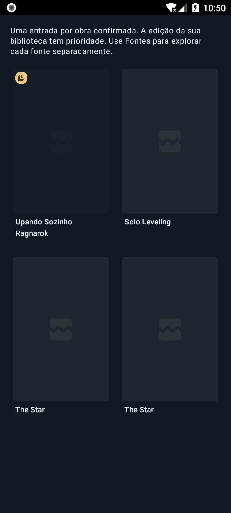

# Busca por obra — P20261109.1

Revisão de desenvolvimento da beta.11/código 112, posterior a 5a0a8bf. A beta.10 pública, main e seus assets permanecem inalterados.

[Comportamento, limites e pendências](../../../docs/BUSCA_UNIFICADA_P20261109_1.md).

A busca global de quadrinhos passa a uma grade por obra corroborada e inicia em Todas as fontes habilitadas, com visualização por fonte disponível. O resultado pode reutilizar uma favorita compatível da biblioteca; candidatos preservam memo atual e fonte fixada. A confirmação tem limites de requisições/concorrência, conserva homônimos e sequências e não transmite campos internos Polaris do memo ao provedor. Não há modelo, dependência ou esquema de backup novo.

## Verificação

- **811/811 casos JVM passaram:** todos os 782 casos da revisão anterior permanecem presentes, sem falhas/skips. Os 29 casos novos cobrem aliases PT/EN, homônimos, sequências, tipo de conteúdo, URLs, ponte de autoria, favorita ambígua, preservação de favoritos/memo/pin, metadados incorretos, limites de concorrência e cancelamento, campos internos e 1000 resultados distintos. [Comparação](unit-comparison.json) e [JUnit](junit).
- **13 controles passaram:** quatro de aplicação/deriva/idempotência/CRLF/gate do overlay e nove do empacotador. A aplicação em checkout limpo confere agora a presença da busca nova e a remoção de manager/logo legados, incluindo exclusões já indexadas no diff composto.
- **12 casos Android passaram em API 26 x86_64**, resolução 720×1600/dpi 320: os 11 componentes anteriores de sandbox/idioma/ícones/perfil/imagens e o novo agrupamento/grade sintética. [Rodada final](android-final.log).
- **Primeira rodada Android:** 11 aprovações e um timeout de 45 s na abertura do fixture anterior de personalização, com diálogo recorrente de ANR do System UI; a busca nova passou, mas a captura estava escurecida por essa janela. O botão Close App reiniciou somente System UI. A mesma rodada completa passou depois, sem mudar código nem desabilitar verificação/SELinux. [Registro anterior](android-before-system-ui-restart.log) e [recuperação](system-ui-recovery.json). Isso não mede desempenho físico de um celular.
- **346 caminhos do overlay conferem com os fontes compilados, incluindo cinco exclusões de arquivos da base.** [Hashes e exportação](compiled-overlay.json). Os APKs de teste são x86_64/debug, não pacotes de distribuição para o celular.
- Os arquivos de dependências permanecem iguais aos auditados na revisão anterior. A consulta OSV anterior está preservada lá; não foi repetida nem estendida a bibliotecas de extensões nesta etapa.

[Resultado estruturado](TEST_RESULTS.json) e [hashes das evidências](SHA256SUMS.txt).

## Captura da grade

Metadados escritos para o teste, sem fontes reais, conta, covers remotos ou banco pessoal. O fixture reutiliza o componente real da grade; a barra da tela de pesquisa não faz parte dessa captura. Ragnarok PT/EN reaproveita a favorita de ID 99, com três edições numa entrada. Solo Leveling permanece outra obra. Os dois The Star são homônimos com autoria diferente (Alice/Bob), intencionalmente separados. O ícone dourado marca a favorita; as imagens são placeholders.

**As entradas antigas já duplicadas dentro da biblioteca ainda não são consolidadas.** Categorias, progresso, histórico, glossários, fontes fixadas e downloads existentes precisam continuar acessíveis pela entrada unificada antes de ocultar registros. Continuam pendentes o fluxo completo com backup/fontes reais, ida/volta por banco/interface de leitores externos e desempenho/compatibilidade em ARM32/A12 e ARM64. Esta etapa não declara a sandbox ampla ou todos os trabalhos da beta.11 concluídos.
